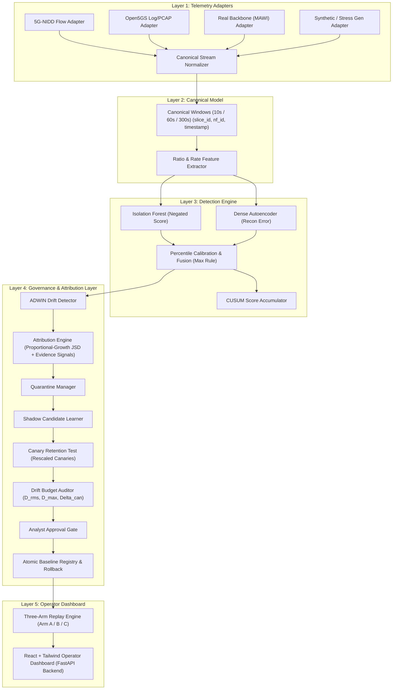

# CommShield Architecture Specification

## 1. End-to-End Data Flow



| Step | Component | Input | Output | Invariants |
| :--- | :--- | :--- | :--- | :--- |
| **1** | Telemetry Adapters | Raw PCAP, flow CSV, NF JSON logs | Normalized events with hashed UE IDs | Plaintext SUPI/IMSI never leaves adapter; raw IPs hashed or subnet-masked |
| **2** | Canonical Windowing | Normalized telemetry events | Canonical Traffic Window JSON | Strict keys: `(slice_id, nf_id, window_start, window_end)` |
| **3** | Feature Extractor | Canonical raw counters | Ratio and rate vectors | Log-transform applied; robust scaling parameters sourced from active baseline |
| **4** | Detection Engine | Ratio feature vector | Detector scores & fused percentiles | Detectors trained exclusively on benign data; scores mapped to benign percentiles |
| **5** | Attribution Engine | Fused scores + composition vectors | Attribution verdict (`likely_benign`, `likely_attack`, `uncertain`) | Every `uncertain` decision provides a named machine-readable reason |
| **6** | Governance Layer | Candidate baseline + quarantine stream | Gated promotion verdict / Rollback | Cumulative budgets $D_{\text{rms}}, D_{\text{max}}, \Delta_{\text{can}}$ and canary recall strictly enforced |
| **7** | Operator Layer | Stream replay / pipeline snapshots | Dashboard metrics, SHAP, and decision traces | No client-side ML; all metrics generated via real backend pipeline runs |

---

## 2. Module Boundaries & Responsibilities

| Module | System Path | Strict Responsibilities | Forbidden Actions |
| :--- | :--- | :--- | :--- |
| **Adapters** | `ml_engine/preprocessing/adapters/` | Ingest heterogeneous captures; pseudonymize identifiers; map to standard field names | Generating anomaly scores; leaking unhashed UE IDs |
| **Feature Extraction** | `ml_engine/preprocessing/features/` | Window aggregation (10s, 60s, 300s); ratio calculation; robust scaling | Maintaining state across disparate slices |
| **Baseline Package** | `ml_engine/baseline/` | Serializing atomic baseline artifacts (models, scalers, thresholds, anchor ref) | Auto-promoting candidates into production without governance verification |
| **Detection Engine** | `ml_engine/detection/` | Unsupervised scoring via Isolation Forest & Autoencoder; percentile calibration; CUSUM | Using attack labels during training; making retrain decisions |
| **Attribution Engine** | `ml_engine/attribution/` | ADWIN drift tracking; Jensen-Shannon divergence proportional growth test; abstention logic | Declaring definitive "root causes" (only evidence hypotheses) |
| **Governance Engine** | `ml_engine/governance/` | Quarantine buffer management; canary retention testing; cumulative drift budgeting | Skipping holdout tests; partial parameter overwrites |
| **Evaluation Engine** | `ml_engine/evaluation/` | Three-arm replay (A: Static, B: Naive Retrain, C: CommShield); evasion benchmarking | Hard-coding metrics or synthetic results |
| **API Layer** | `backend/app/api/` | FastAPI routers; request validation; database persistence; SSE/replay stream coordination | Executing heavy ML operations in event loop threads |
| **Frontend UI** | `frontend/src/` | React SPA; `h-screen` layout; fixed sidebar; Recharts visualizer; audit decision viewer | Running ML inference; computing drift metrics locally |

---

## 3. Telemetry Adapters to Canonical Schema

```json
{
  "adapter_interface_signature": {
    "protocol": "TelemetryAdapterProtocol",
    "methods": [
      {
        "name": "parse_records",
        "input": "Iterable[Union[bytes, str, dict]]",
        "output": "Iterator[CanonicalTelemetryEvent]"
      },
      {
        "name": "aggregate_window",
        "input": {
          "events": "List[CanonicalTelemetryEvent]",
          "slice_id": "str",
          "nf_id": "str",
          "window_duration_sec": "int"
        },
        "output": "CanonicalTrafficWindow"
      }
    ]
  }
}
```

| Source | Adapter Implementation | Input Format | Mapping to Canonical Schema |
| :--- | :--- | :--- | :--- |
| **5G-NIDD** | `NiddFlowAdapter` | Flow CSV (Bi-directional netflow) | Hashed IPs $\to$ `ue_hash_entropy`, bytes/packets $\to$ `bytes_per_session`, protocol/port $\to$ `protocol_distribution` |
| **Open5GS** | `Open5gsLogAdapter` | NF JSON logs / PCAP captures | Signalling events $\to$ `registration_attempts`, NAS/PFCP codes $\to$ `nas_failure_ratio`, `pfcp_failure_ratio` |
| **MAWI Trace**| `MawiBackboneAdapter` | Public backbone pcap/flow | Backbone traffic curve $\to$ background organic volume scaling factor $k$ |
| **Synthetic** | `SyntheticSliceAdapter`| Parametric generator JSON | S-NSSAI slices $\to$ controlled injection of floods, ramps, and proportional growth |

---

## 4. Pluggable Engine Interfaces

### A. Detection Engine Interface

```json
{
  "interface": "BaseAnomalyDetector",
  "methods": {
    "fit": {
      "inputs": {
        "train_windows": "List[CanonicalTrafficWindow]",
        "val_windows": "List[CanonicalTrafficWindow]"
      },
      "outputs": "FitSummary"
    },
    "score_window": {
      "inputs": {
        "window": "CanonicalTrafficWindow"
      },
      "outputs": {
        "raw_score": "float",
        "benign_percentile": "float",
        "is_anomalous": "bool"
      }
    }
  },
  "pluggable_implementations": [
    "IsolationForestDetector",
    "DenseAutoencoderDetector",
    "FusedPercentileDetector"
  ]
}
```

### B. Attribution Engine Interface

```json
{
  "interface": "BaseAttributor",
  "methods": {
    "attribute_window": {
      "inputs": {
        "current_window": "CanonicalTrafficWindow",
        "baseline_context": "BaselineContext",
        "fused_detector_score": "float",
        "control_slice_window": "Optional[CanonicalTrafficWindow]"
      },
      "outputs": {
        "verdict": "Enum[likely_benign, likely_attack, uncertain]",
        "abstain_reason": "Optional[Enum[insufficient_baseline_history, volume_composition_disagree, detectors_disagree, inconclusive_growth_pattern, cannot_separate_attack_from_growth]]",
        "jsd_divergence": "float",
        "scaling_factor_k": "float",
        "evidence_signals": "Dict[str, float]"
      }
    }
  },
  "pluggable_implementations": [
    "HandwrittenRulesAttributor",
    "SmallClassifierAttributor"
  ]
}
```

### C. Governance Engine Interface

```json
{
  "interface": "BaseGovernanceManager",
  "methods": {
    "evaluate_candidate": {
      "inputs": {
        "candidate": "CandidateBaselinePackage",
        "active_baseline": "ActiveBaselinePackage",
        "trusted_anchor": "AnchorBaselinePackage",
        "canary_dataset": "List[CanaryAttackWindow]",
        "normal_holdout": "List[CanonicalTrafficWindow]"
      },
      "outputs": {
        "decision": "Enum[APPROVED, REJECTED, PENDING_APPROVAL]",
        "gate_results": {
          "holdout_fpr_test": "GateMetricResult",
          "canary_retention_test": "CanaryMetricResult",
          "step_limit_test": "DistanceMetricResult",
          "cumulative_budget_test": "DistanceMetricResult",
          "max_feature_shift_test": "DistanceMetricResult",
          "canary_shift_test": "DistanceMetricResult"
        },
        "decision_trace": "List[str]"
      }
    },
    "atomic_rollback": {
      "inputs": { "target_version": "str", "reason": "str", "operator_id": "str" },
      "outputs": { "status": "str", "active_version": "str", "restored_at": "str" }
    }
  }
}
```

---

## 5. Ordered Milestones

| Milestone | Target Scope | Core Deliverables | Verification Criterion |
| :--- | :--- | :--- | :--- |
| **M1: Vertical Slice** | Replay Pipeline & UI Skeleton | End-to-end flow: select dataset, run replay stream, display live traffic chart & anomaly flags in UI | Synthetic/sample stream plays at 1x-10x; alerts render in React dashboard |
| **M2: Feature 1** | Per-Slice Baseline Learning | 10s/60s windowing, ratio feature extractor, robust scaling, atomic baseline packaging, trusted anchor | Baseline model packages serializable to SQLite; fallback activates on empty slice |
| **M3: Feature 2** | Multi-Model Unseen Detection | IF + Dense AE, benign-percentile calibration, max-fusion rule, CUSUM accumulation, SAGE-5GC evasion test | Leave-one-attack-out benchmark beats z-score baseline; complementary state matrix logged |
| **M4: Feature 3** | Drift Attribution & Abstention | ADWIN trigger, proportional-growth JSD test with smoothing, evidence signals, 5 named abstention reasons | Attributor outputs `likely_benign`, `likely_attack`, or `uncertain` with named reason on test streams |
| **M5: Feature 4** | Approval-Gated Adaptation | Quarantine buffer, shadow candidate generation, canary retention test with rescaled canaries, drift budget ($D_{\text{rms}}, D_{\text{max}}, \Delta_{\text{can}}$), atomic rollback | Poisoning ramp blocked by cumulative budget or canary test; atomic rollback restores model+scaler+thresholds |
| **M6: Feature 5** | Investigation Dashboard | Three-Arm Replay (Arm A: None, Arm B: Naive, Arm C: CommShield), SHAP for flagged windows, Model Health card, Decision Traces | Operator can inspect decision traces, approve/reject pending candidates, trigger rollback, and view live arms |

---

## 6. Open Questions

| ID | Module | Spec Section Reference | Question / Ambiguity | Temporary Architectural Assumption |
| :--- | :--- | :--- | :--- | :--- |
| **OQ-A1** | Adapters | F1 / Data & Limitations | Exact slice identifiers are unconfirmed in public 5G-NIDD captures. | Adapter maps IP subnet ranges to 2 synthetic S-NSSAI slices (`eMBB-01` and `uRLLC-02`) when explicit slice tags are absent. |
| **OQ-A2** | Preprocessing | F1 / Context caveat | Day-of-week context conditioning requires multi-week continuous captures, which 5G-NIDD lacks. | Hour-of-day conditioning enabled only if capture exceeds 24h; otherwise default to global diurnal model. |
| **OQ-A3** | Governance | F4.B / Canary rescaling | Spec notes two variants: proportional scaling vs fixed absolute volume. | Implement both: primary evaluation uses proportional ratio scaling; secondary ablation uses fixed volume. |
| **OQ-A4** | Operator Layer | F5 / Investigation Dashboard | Real-time replay transport mechanism (WebSocket vs Server-Sent Events vs polled REST). | FastAPI REST endpoints with Server-Sent Events (SSE) `/api/v1/replay/stream` for real-time frontend chart updates. |
<!-- CommShield AI Core -->
